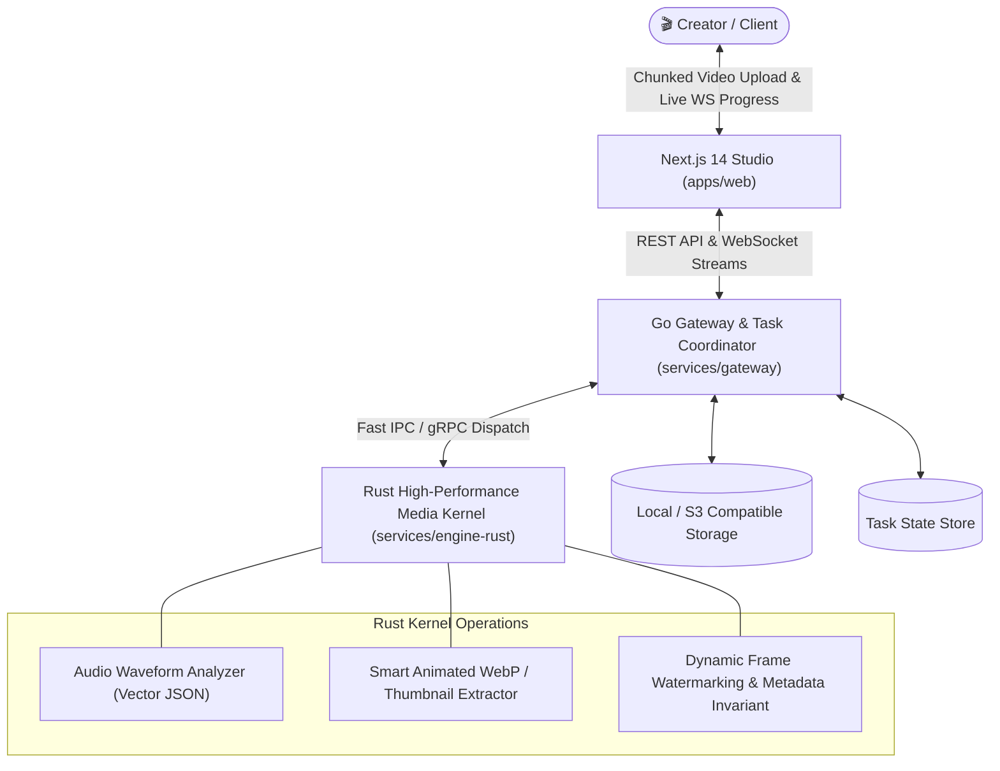

# 🎬 StreamForge (स्ट्रीमफोर्ज)

<div align="center">

[](https://github.com/prachizala/StreamForge/actions)
[](https://opensource.org/licenses/MIT)
[](https://go.dev/)
[](https://www.rust-lang.org/)
[](https://nextjs.org/)

**High-Throughput Real-Time Media & Video Pipeline Engine combining Next.js 14, Go Gateway, and a Rust Media Compute Kernel.**

[Architecture](#-system-architecture) • [Key Capabilities](#-key-capabilities) • [Directory Layout](#-monorepo-layout) • [Quickstart](#-quickstart)

</div>

---

## ⚡ Overview

**StreamForge** is an enterprise-grade distributed media processing pipeline designed to handle high-frequency video uploads, audio waveform extraction, smart frame thumbnailing, and dynamic watermarking with sub-millisecond execution guarantees.

Engineered with the bleeding-edge modern triumvirate:
1. **Next.js 14 (App Router & WebSockets):** Real-time Creator Studio UI with live progress streaming, interactive audio waveform renderers, and instant media player previews.
2. **Go Gateway & Worker Coordinator:** High-concurrency job scheduler leveraging Goroutines, worker thread pools, WebSocket pub/sub broadcasting, and atomic state machines.
3. **Rust Media Kernel:** High-performance, zero-garbage-collection native compute engine executing heavy frame manipulations, perceptual hashing, and byte-level audio sampling.

---

## 🏛️ System Architecture



---

## 🚀 Key Capabilities

* **Deterministic Non-Blocking Processing:** Go Goroutine pool decouples HTTP uploads from background processing pipelines.
* **Sub-Millisecond Waveform Extraction:** Native Rust byte parser calculates RMS audio amplitudes directly from media streams.
* **Live WebSocket Telemetry:** Real-time job progress (0% -> 100%) streamed frame-by-frame directly to the Next.js UI.
* **Memory Safety & Zero Leaks:** Rust kernel guarantees zero buffer overflows and predictable deterministic RAM consumption.

---

## 📁 Monorepo Layout

```
StreamForge/
├── apps/
│   └── web/                     # Next.js 14 Creator Studio (App Router)
│       ├── app/                 # Dashboard, Media Upload, Real-Time Player
│       ├── components/          # Waveform Visualizer, Dropzone, Progress Bar
│       └── package.json
├── services/
│   ├── gateway/                 # Go High-Concurrency API & WebSocket Hub
│   │   ├── cmd/server/          # Entrypoint (main.go)
│   │   ├── internal/api/        # HTTP Handlers (Upload, Status, Stream)
│   │   ├── internal/queue/      # Worker Pool & Dispatcher
│   │   ├── internal/ws/         # WebSocket Client Hub
│   │   └── go.mod
│   └── engine-rust/             # Rust Native Compute Kernel
│       ├── Cargo.toml
│       ├── src/main.rs          # CLI & Native Worker Entrypoint
│       └── src/pipeline/        # Waveform, Thumbnail, Watermark Pipelines
├── .github/
│   └── workflows/ci.yml         # Matrix CI for Go, Rust, and Next.js
├── docker-compose.yml
└── README.md
```

---

## 🛠️ Quickstart

### Prerequisites
* Go 1.22+
* Rust 1.75+ (Cargo)
* Node.js 18+ (pnpm / npm)

### 1. Run Go Gateway
```bash
cd services/gateway
go run cmd/server/main.go
```

### 2. Run Rust Engine
```bash
cd services/engine-rust
cargo run -- --help
```

### 3. Run Next.js Creator Studio
```bash
cd apps/web
npm install
npm run dev
```

---

## 📜 License
Distributed under the MIT License. Built with ❤️ by [Prachi Zala](https://github.com/prachizala).
